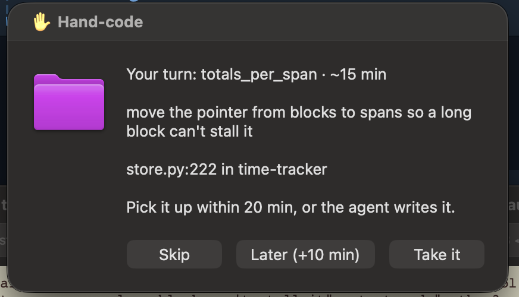
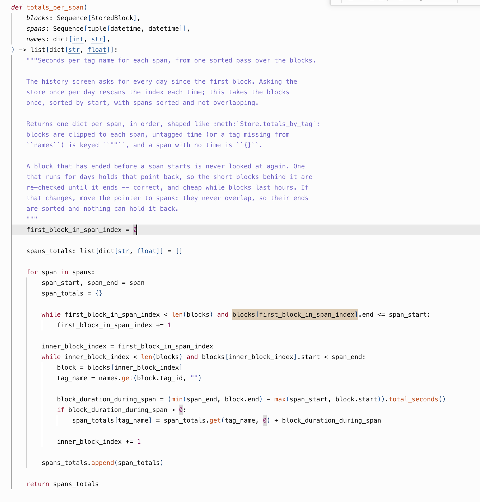
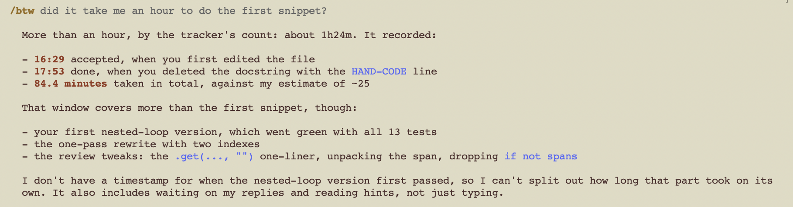
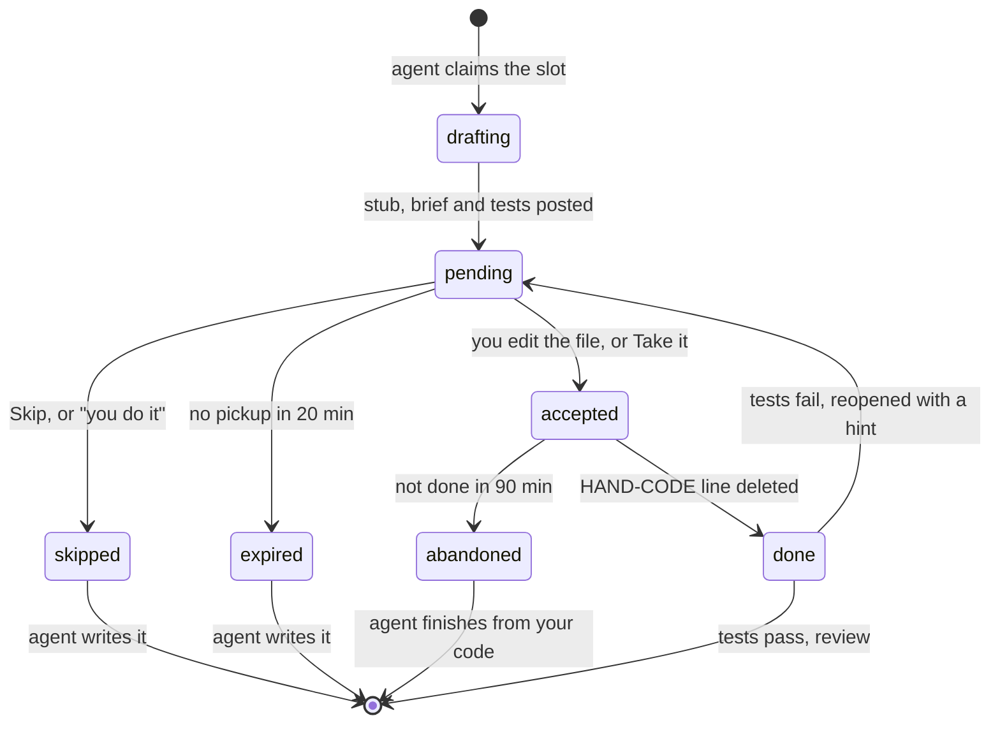

# ✋ human-autocomplete

**Your agent writes the signature and the failing tests. You get to finish the function.**

Copilot used to autocomplete you. Now you get to autocomplete the agent.

Run a few Claude Code sessions in parallel and a week can go by without you writing a single function. human-autocomplete fixes that without slowing anything down. Now and then, when an agent is about to write a self-contained piece of real logic, it hands that piece to you instead. You get it set up like a good interview problem, but it's code your project needs today, not a puzzle.

You have 20 minutes to pick it up. If you don't, the agent writes it and nobody waits.

## What a request looks like

A pop-up that stays on screen until you answer it:

<p align="center">
  
</p>

**Take it** opens your editor on a stub whose doc comment is the problem statement:

```ts
/**
 * HAND-CODE(hc-7f3a) — your turn. Delete this line when you're done.
 *
 * parseRetryAfter: turn a Retry-After header into a delay in ms.
 *
 * Context: the webhook sender retries 429/503 responses. Called from
 * sendWithRetry() (src/webhooks/sender.ts:88) with the raw header value.
 *
 * Input:
 *   header: string | undefined. Either delta-seconds ("120") or an HTTP-date.
 *   now: Date. Current time, injected for tests.
 * Output:
 *   number | null. Delay in ms clamped to [0, 1h]; null if missing or unparseable.
 *
 * Examples:
 *   parseRetryAfter("120", now)                           → 120000
 *   parseRetryAfter("Wed, 21 Oct 2026 07:28:00 GMT", now) → ms until then, 0 if past
 *   parseRetryAfter("soon", now)                          → null
 *
 * Constraints: no new dependencies; never throws.
 * Tests: src/webhooks/__tests__/retryAfter.test.ts · run: yarn jest retryAfter
 * Estimate: ~20 min · medium
 */
export function parseRetryAfter(header: string | undefined, now: Date): number | null {
  throw new Error("not implemented");
}
```

The tests are already written and failing, and the callers are already wired to the stub. While you work, the agent carries on with the rest of the task.

When you're finished, delete the `HAND-CODE` line. The agent then runs the tests:

- **They pass.** It tidies the brief into a normal doc comment and gives you a short code review: two to four concrete points, as suggestions, never edits to your code.
- **They fail.** It tells you which cases fail, with a hint rather than the fix, and you get one more go.
- **They fail again.** It makes the smallest fix itself and shows you exactly what it changed.

You can ask for hints along the way. The agent answers like an interviewer: it clarifies the contract and nudges, but doesn't write the code for you.

## A real one

This one came from building the history screen of a time tracker. The function splits time-sorted activity blocks into per-day totals for each tag, clipping any block that crosses midnight, all in one pass. It started as a stub with 13 failing tests and ended as this. The body was written by hand, with the agent answering questions and giving hints; the docstring is the brief, tidied up by the agent afterwards.

<p align="center">
  
</p>

It keeps time, too:

<p align="center">
  
</p>

Estimate: 25 minutes. Actual: 84. That's the fun part.

## Why it doesn't get annoying

- **One at a time, machine-wide.** A single coordinator covers every Claude Code session on the machine, so parallel agents can't pile up requests.
- **At most one an hour.** The cooldown starts when the previous request ends.
- **Never blocks.** The agent waits in the background and keeps working. If you don't pick it up, it writes the code, with no guilt-tripping.
- **Only real work.** It only hands over a function the current task needs in the next few minutes, with a clear contract and edge cases worth thinking about. It never hands over glue, renames, types, config, UI styling or security-critical code, and never invented puzzles.
- **Quiet when nobody's there.** Subagents, headless `claude -p` and SDK runs, and cloud sessions never ask.
- **On demand.** Say "give me something to code" and you get one now, cooldown or not.

## Install

### As a Claude Code plugin (recommended)

```
/plugin marketplace add aleks-tpom6oh/human-autocomplete
/plugin install human-autocomplete@human-autocomplete
```

Then restart Claude Code. This installs the skill and a small `UserPromptSubmit` hook. The hook is what tells agents a slot is open.

Inside the plugin, the skill, the `handcode` command and the `HAND-CODE` marker are all called "hand-code", after the action.

### By hand

```bash
git clone https://github.com/aleks-tpom6oh/human-autocomplete ~/src/human-autocomplete
ln -s ~/src/human-autocomplete/skills/hand-code ~/.claude/skills/hand-code
```

Then add the hook to `~/.claude/settings.json`:

```json
{
  "hooks": {
    "UserPromptSubmit": [
      {
        "hooks": [
          {
            "type": "command",
            "command": "python3 \"$HOME/.claude/skills/hand-code/scripts/handcode\" hook",
            "timeout": 5
          }
        ]
      }
    ]
  }
}
```

### Optional extras

- **`brew install terminal-notifier`.** Clicking a notification then opens the stub in your editor.
- **A `handcode` command in your shell.** You don't need it, since the pop-up and plain chat cover everything, but it's handy:

  ```bash
  # by-hand install
  ln -s ~/src/human-autocomplete/skills/hand-code/scripts/handcode ~/.local/bin/handcode

  # plugin install: add to ~/.zshrc or ~/.bashrc
  handcode() { python3 "$(ls -dt ~/.claude/plugins/cache/human-autocomplete/human-autocomplete/*/ | head -1)skills/hand-code/scripts/handcode" "$@"; }
  ```

## Using it

Mostly you don't do anything; you work as usual. When a request arrives:

| You want to | Do this |
|---|---|
| take it | Click **Take it**, or just start editing the file |
| pass | Click **Skip**, or tell the agent "you do it" |
| finish | Delete the `HAND-CODE` line, or tell the agent "done" |
| get more time | Click **Later**, or run `handcode extend 20` |
| get a hint | Ask the agent |

From the shell:

| Command | Effect |
|---|---|
| `handcode status` | What's happening and how much time is left |
| `handcode show` / `open` | Print the brief / open the stub in your editor |
| `handcode accept` / `skip` / `done` | Take it / pass / mark it finished |
| `handcode test` | Run the request's tests |
| `handcode extend 20` | Add 20 minutes to the current window |
| `handcode pause 2h` / `off` / `on` | Quiet for a while / until turned back on |
| `handcode reset` | Clear the cooldown so a request can come now |
| `handcode stats` | History: what you took, skipped and passed, and your median time |

## How it works



There are three parts:

- **The skill** ([`skills/hand-code/SKILL.md`](skills/hand-code/SKILL.md)) teaches the agent what makes a good request and how to set one up fairly. All tests must fail with "not implemented" and nothing else before you see them. The skill also covers waiting without blocking, and what to do with each outcome.
- **The coordinator** ([`skills/hand-code/scripts/handcode`](skills/hand-code/scripts/handcode)) is one standard-library Python file. It keeps a file-locked state in `~/.claude/hand-code/` and enforces the limits for every session at once. It decides you've picked a request up when the stub file changes on disk, and that you're done when the `HAND-CODE(<id>)` marker disappears. Agents watch for this with `handcode wait`, run in the background, so they're woken when it resolves.
- **The hook** adds one line of context to your prompts, and only while a slot is open. That line is what makes an agent consider handing something over. During the cooldown it prints nothing, so it costs nothing.

## Configuration

Create `~/.claude/hand-code/config.json` with any of these keys:

| Key | Default | Meaning |
|---|---|---|
| `cooldown_min` | `60` | Quiet time after a request ends |
| `accept_min` | `20` | How long you have to pick a request up |
| `work_min` | `90` | How long you have to finish once you've picked it up |
| `draft_min` | `15` | How long a claimed but never posted request holds the slot |
| `dialog` | `true` | Show the Take it / Skip / Later pop-up (macOS) |
| `notify` | `true` | Show notifications at all |
| `sound` | `"Glass"` | Notification sound |
| `editor` | none | `cursor`, `code`, `zed`, `subl`, …; tries them in that order if unset |

Environment variables override the file:

| Variable | Overrides |
|---|---|
| `HAND_CODE_COOLDOWN_MIN`, `HAND_CODE_ACCEPT_MIN`, `HAND_CODE_WORK_MIN`, `HAND_CODE_DRAFT_MIN` | The matching keys above |
| `HAND_CODE_EDITOR` | `editor` |
| `HAND_CODE_NO_NOTIFY` | Turns notifications off |
| `HAND_CODE_DISABLE` | Silences the hook |
| `HAND_CODE_HOME` | The state directory |

### Turning it down

- **For a while:** `handcode pause 2h`, or `handcode off` until you run `handcode on`.
- **For one project:** run `/skills` inside that project and switch hand-code off.

## Requirements

- Claude Code
- Python 3.9 or later, standard library only (the `python3` that ships with macOS works)
- **macOS:** the full experience, with the pop-up and notifications
- **Linux:** works, with notifications through `notify-send` and no pop-up
- **Windows:** not supported yet, because the coordinator locks its state file with `fcntl`

Everything stays on your machine. State and history live in `~/.claude/hand-code/`, and the coordinator makes no network calls.

## License

[MIT](LICENSE)
